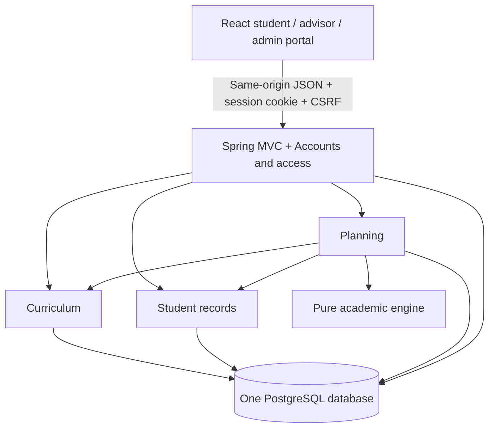

# Architecture and requirements

The implementation follows the supplied `Academic_Path_Planner_Architecture` and `Academic_Path_Planner_Presentation` documents. The stack and five-module modular monolith are retained. Advisor workflows and timetable checks are included now because the presentation lists them as core capabilities; this extends the smaller first-version workflow without changing its structure.

## Module responsibilities

| Module              | Responsibility                                                                                                                                        | Owned tables             |
| ------------------- | ----------------------------------------------------------------------------------------------------------------------------------------------------- | ------------------------ |
| Accounts and access | BCrypt passwords, planner registration/login, sessions, student ownership and assigned-advisor access                                                 | `users`                  |
| Curriculum          | Immutable curriculum versions, draft review/publication, course catalog, elective groups, recurring/year-specific course availability and class times | `curricula`, `offerings` |
| Student records     | Multiple attempts across terms, current enrollment, passed/failed attempts, transfer approval, import preview and atomic confirmation                 | `academic_records`       |
| Planning            | Starting drafts, targets, saved paths, nonpersistent simulations, independent scenario copies, comparison and advisor review                          | `plans`, `reviews`       |
| Academic engine     | Prerequisites, credit totals and loads, elective groups, offerings, timetable clashes, conditional graduation and suggested-path generation           | None                     |

Modules call Java services directly. Shared record types are immutable snapshots at the engine boundary. Persistence uses Spring JDBC with parameterized queries. Curriculum versions and plan contents use PostgreSQL JSONB; users, attempts and reviews use relational constraints. Flyway owns database migrations.

## Coverage of the supplied workflows

| Document capability                       | Implemented behavior                                                                                                              |
| ----------------------------------------- | --------------------------------------------------------------------------------------------------------------------------------- |
| Planner accounts and curriculum selection | Register a student with a published program/year; session login and logout                                                        |
| Review progress and import records        | Manual entry, CSV/JSON preview, explicit confirmation, passed/current/failed/transfer status, multiple attempts                   |
| Approved transfer credit                  | Pending transfer records do not count; assigned advisors/admins approve them                                                      |
| Versioned requirements and electives      | Required courses, prerequisites, elective credit groups, selected choices and version-preserving plans                            |
| Starting draft                            | Deterministic greedy placement in offered terms, prerequisite order, timetable and ECTS limits; unmet requirements remain visible |
| Semester planning                         | Add/remove terms and courses; drag/drop and accessible Move buttons; save/reset and conflict detection                            |
| Add/drop/move/fail simulations            | Temporary draft changes plus `failedCourses` assumptions; original transcript remains intact                                      |
| Graduation target and forecast            | Conditional finish only when valid and complete; on-track, after-target, incomplete and invalid outcomes stay distinct            |
| Credit and timetable constraints          | Per-term ECTS, summer cap, prior-term prerequisites, recurring/year-specific offerings and weekly slot overlap checks             |
| What-if comparison                        | Separate plan copies with per-semester course/load and forecast comparison                                                        |
| Advisor-friendly review                   | Submitted revision, assigned student scope, full validation details, approval or change request, export and review history        |
| Reviewed curriculum imports and edits     | JSON/CSV validation, manual course editor, cycle checks, affected-student count, draft review before publication                  |
| Recheck after data changes                | Evaluation is recomputed when opening or previewing a plan; no stale cached engine result                                         |
| Preserve choices on curriculum changes    | Old versions remain; students explicitly preview and save a version upgrade                                                       |
| Optional university integration           | Remains a future connector requiring authorized SDU access, as described in the architecture                                      |
| Guaranteed fastest path                   | Remains a future optimizer; the shipped generator provides a feasible starting draft and does not assert global optimality        |

## Academic rules and assumptions

- A prerequisite must be earned already or scheduled in a strictly earlier semester. Same-term enrollment does not satisfy it.
- An approved transfer and repeated passing attempts count as one course. Pending transfers do not earn credit.
- Required-course credits and each elective-group requirement must be met. Extra elective credit does not substitute for a different requirement.
- A year-specific offering overrides a recurring offering, including an explicit unavailable override. Missing offerings are unavailable.
- Weekly classes conflict when their day matches and time ranges overlap. Adjacent classes are allowed. No official offering or timetable is inferred from a curriculum's suggested semester.
- The regular maximum comes from the curriculum; summer allows at most 15 ECTS. Underload is a warning.
- Planned courses before the reference current term are errors. Historical coursework belongs in academic records.
- A plan may be saved while incomplete or invalid so a student can return to it; it receives no confirmed finish. Advisor approval requires a valid, complete, submitted plan.
- Forecasts assume future passes and continued availability. A target is a comparison input, not an academic rule override.
- The generator searches a bounded 30-term horizon, respects current enrollment, chooses enough electives, and places courses by suggested-semester priority. Cycles are rejected when a curriculum is reviewed. Unavailable or otherwise unplaceable requirements remain missing instead of receiving fictitious placements.

## Consistency and access

Student writes are scoped to the authenticated owner. Advisors see only assigned students; administrators can manage curricula and review students. Registration accepts no role field. CSRF protection applies to mutations, authentication uses HTTP-only same-site session cookies, and credentials stay out of API user responses.

Saving a plan checks its revision, returns HTTP 409 on a concurrent change, and clears its submitted state. Each review records the reviewed revision and a SHA-256 fingerprint of plan, curriculum, records and offerings. A changed input marks the review outdated even if the plan revision did not change. Published curricula are never edited in place.

These are planning checks, not registration or university degree certification. The supplied sample catalog and timetable are explicitly illustrative.
